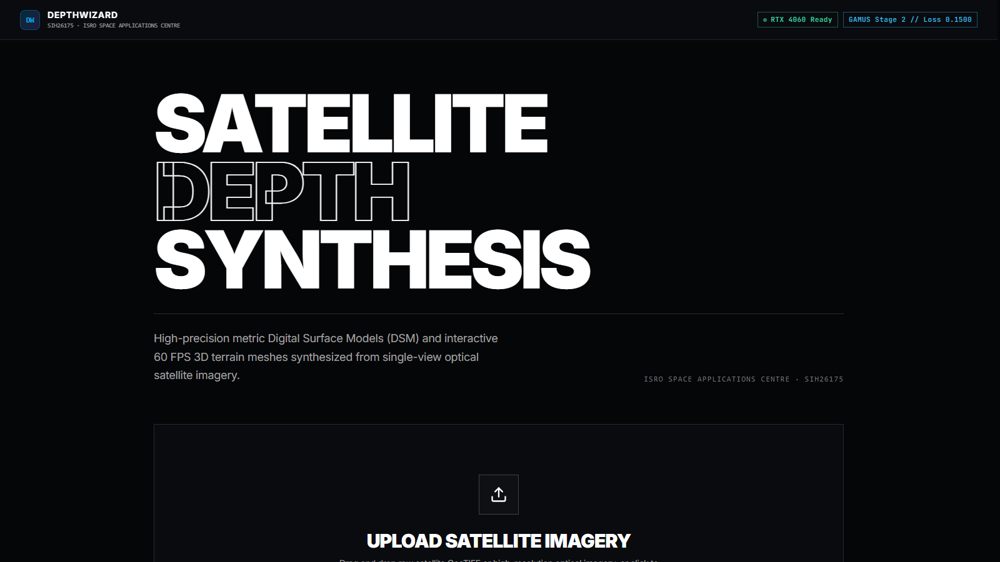
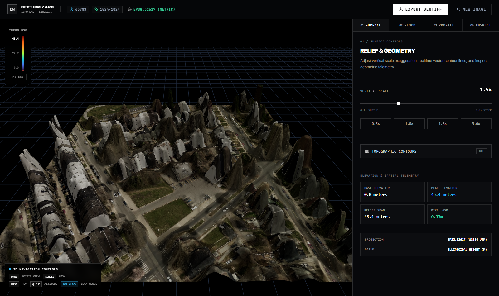
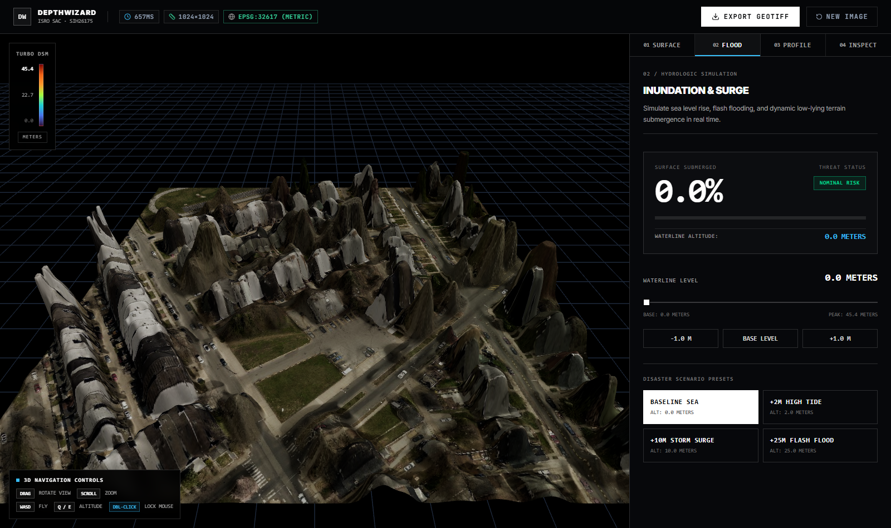
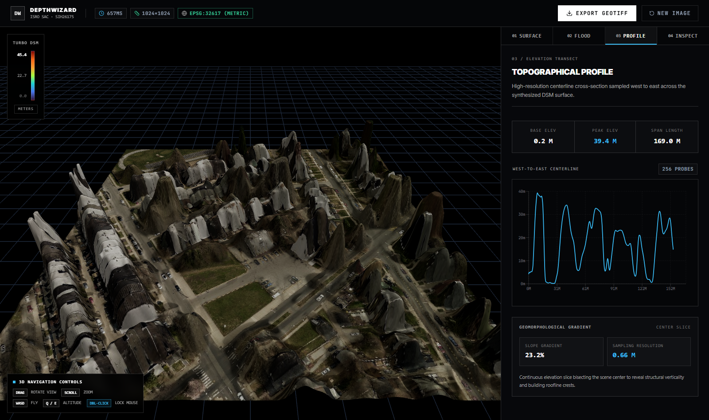
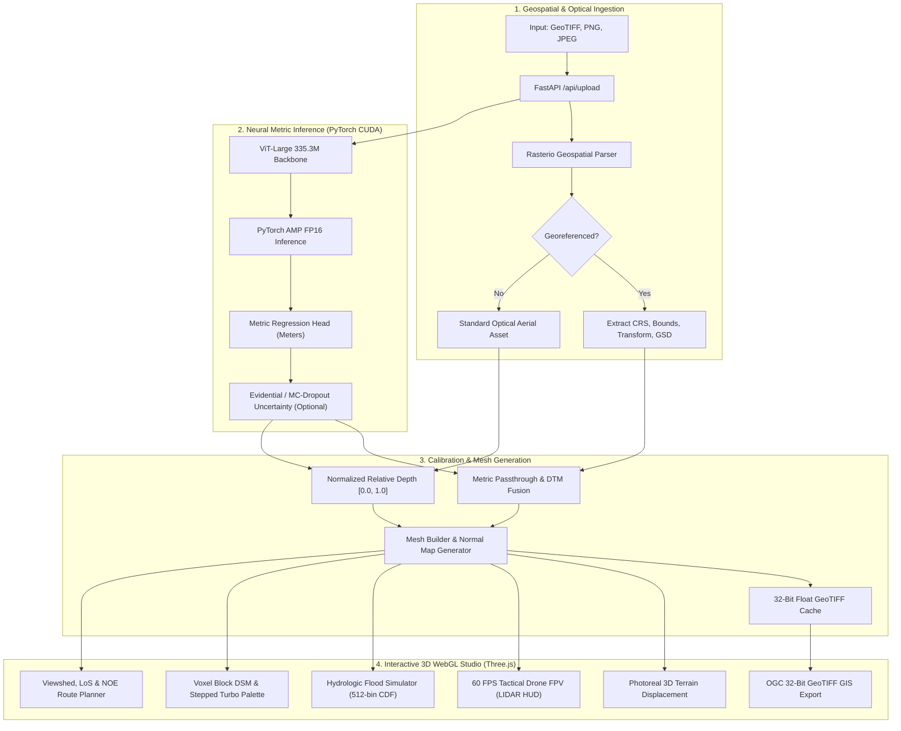

# 🧙‍♂️ DepthWizard — Single-View Optical Satellite to Metric DSM & 3D Digital Twin

### High-Precision Monocular Elevation Reconstruction, Hydrologic Inundation Modeling & Real-Time 60 FPS Drone Avionics
**Space Applications Centre (SAC), ISRO · Smart India Hackathon 2026 (SIH26175) · Theme: Disaster Management · Team: DEBUG MAXXING**

---

[](https://www.python.org/)
[](https://pytorch.org/)
[-792EE5.svg)](https://huggingface.co/depth-anything)
[](https://fastapi.tiangolo.com/)
[](https://react.dev/)
[](https://threejs.org/)
[](https://vitejs.dev/)
[](LICENSE)

---

## 🌍 Overview

In disaster operations (flash floods, cyclone storm surges, landslides), emergency rescue teams require immediate, high-fidelity 3D elevation models without waiting for expensive aerial LiDAR or multi-pass stereo satellite pairs.

**DepthWizard** solves this challenge by reconstructing an **absolute metric 3D Digital Surface Model (DSM)** from a **single monocular satellite or aerial optical image** in **under 1 second**. It powers an interactive **60 FPS Three.js WebGL digital twin** equipped with real-time hydrologic flood simulation, tactical drone FPV flight avionics, volumetric battle damage assessment, and 32-bit OGC GeoTIFF export — running 100% offline and sovereign on local hardware.



---

## ⚡ Key Capabilities

| Feature | Description |
|---|---|
| **True Metric Elevation** | Fine-tuned **ViT-Large backbone (335.3M params)** predicting physical heights directly in **meters ($m$)**, eliminating unitless relative disparity. |
| **60 FPS Tactical Drone FPV** | Real-time 6-DOF drone avionics (`W/A/S/D`, `Space/Q/E`), ray-marched proximity LIDAR array, HUD telemetry (artificial horizon, compass, AGL/MSL altitude), and Autopilot modes (`Manual`, `Orbit`, `Transect`). |
| **Hydrologic Inundation Engine** | 512-bin CDF submergence simulator with real-time waterline controls, emergency presets (+2m tide, +10m surge, +25m flash flood), flooded hectare calculations, and hazard risk tiering. |
| **Voxel Block DSM** | Instanced mesh voxelization rendering stepped topographic blocks (up to 256×256 UI / 512×512 pooling) with discrete Stepped Turbo gradient paletting. |
| **Centerline Transect Profiler** | Interactive 256-probe cross-section profiler graphing elevation distance ($m$), min/max relief, and maximum slope gradient (%). |
| **Dual Ingestion & Matrix Compositor** | Ingests georeferenced GeoTIFFs (`EPSG:32617`, `EPSG:32643`, sub-meter GSD) or standard optical RGB (PNG/JPG); includes a 2×2 grid tile stitching compositor for large mosaics. |
| **Tactical Spatial Analytics** | Integrated 2D observer viewshed masking, point-to-point Line of Sight (LoS), volumetric structural change detection (BDA diff), and autonomous Nap-of-the-Earth (NOE) terrain-following path planning. |
| **32-Bit OGC GeoTIFF GIS Exporter** | Single-band `float32` raster exports preserving CRS, affine transform, and metric elevation for direct integration into **QGIS**, **ArcGIS**, and **ISRO Bhuvan**. |

---

## 📸 Interactive Visualizer

| Terrain Displacement | Flood Inundation Simulator | Elevation Cross-Section |
|---|---|---|
|  |  |  |

---

## 🏗️ Architecture & Processing Pipeline



---

## 🧠 Neural Backbone & Benchmark Accuracy

DepthWizard's vision backbone fine-tunes **`Depth-Anything-V2-Large-hf`** on **17,524 high-resolution satellite and aerial pairs** across diverse environments:
- **GAMUS Dataset** (13,480 samples): Sub-meter urban & suburban structures.
- **DFC2023 Benchmark** (1,595 tiles): Ultra-high-resolution global urban architecture.
- **Open-Canopy Dataset** (16 large tiles): Dense forest canopies, vegetation, and rugged terrain.

### Performance & Validation Benchmarks

| Metric / Parameter | Value |
|---|---|
| **Architecture** | Vision Transformer Large (**ViT-Large/14** + DPT Neck) |
| **Model Parameters** | **335.3 Million Parameters** |
| **Global Urban Accuracy (DFC2023)** | **1.74 m MAE** |
| **Urban Topography Accuracy (GAMUS)** | **2.14 m MAE** |
| **Validation Mean MAE** | **4.91 m** (-33.8% error reduction over baseline) |
| **Inference Latency** | **~250 ms – 650 ms** on NVIDIA RTX 4060 (CPU fallback supported) |
| **Primary Checkpoint** | `backend/weights/metric_best.pth` (~1.34 GB) |

*(Note: PyTorch auto-detects GPU acceleration; if CUDA is unavailable or during local testing, CPU fallback with existing weights is automatically applied).*

---

## 🚀 Quickstart & Installation

### Option 1: One-Click Launch (Windows)
```cmd
run_local.bat
```
*Automatically validates Python virtual environment, launches the FastAPI backend on port `8000`, and starts the frontend dev server.*

### Option 2: Manual Setup

#### 1. Backend Setup
```bash
# Clone the repository
git clone https://github.com/tanishqkr/satellite-image-to-3d-terrain.git
cd satellite-image-to-3d-terrain

# Create and activate virtual environment
python -m venv .venv
# On Windows: .venv\Scripts\activate
# On Linux/macOS: source .venv/bin/activate

# Install dependencies
pip install -r requirements.txt

# Start backend server
python -m uvicorn app.main:app --app-dir backend --host 0.0.0.0 --port 8000
```

#### 2. Frontend Setup
```bash
# In a new terminal:
cd frontend
npm install
npm run dev
```

Access the application at **`http://localhost:5173`** (or `http://localhost:3000`). Interactive API documentation is available at **`http://localhost:8000/docs`**.

---

## 📡 REST API Reference

| Endpoint | Method | Description |
|---|:---:|---|
| `/api/upload` | `POST` | Ingests GeoTIFF / optical image, runs metric inference, and returns heightmap, normal map, and mesh statistics. |
| `/api/export/{request_id}` | `GET` | Downloads the calibrated single-band 32-bit floating point (`float32`) GeoTIFF. |
| `/api/viewshed` | `POST` | Computes 2D observer viewshed visibility, occlusions, and coverage percentage over the terrain. |
| `/api/los` | `POST` | Calculates point-to-point 3D Line-of-Sight clearance and obstacle profiles. |
| `/api/bda/diff` | `POST` | Automated volumetric differencing and structural damage assessment (pre- vs post-event). |
| `/api/route/noe` | `POST` | Computes 3D Nap-of-the-Earth (NOE) terrain-following route corridors avoiding threat exposure. |
| `/api/health` | `GET` | Health check returning device discovery, CUDA availability, and GPU VRAM telemetry. |

---

## 📂 Project Structure

```
depthwizard/
├── backend/
│   ├── app/
│   │   ├── api/routes.py              # FastAPI endpoints (/upload, /export, /viewshed, /bda, /route)
│   │   ├── config.py                  # Model hyperparameters, path configs, and device settings
│   │   ├── services/
│   │   │   ├── depth_estimator.py     # ViT metric depth inference & uncertainty estimation
│   │   │   ├── calibration.py         # True metric passthrough & height calibration
│   │   │   ├── geospatial.py          # Rasterio GeoTIFF parser & affine transform extraction
│   │   │   ├── mesh_builder.py        # 3D heightfield, normal maps & colorization generator
│   │   │   ├── visibility.py          # Observer viewshed & ray-marched Line of Sight (LoS)
│   │   │   ├── change_detection.py    # Pre/post volumetric damage assessment (BDA)
│   │   │   ├── route_planner.py       # 3D Nap-of-the-Earth (NOE) path planner
│   │   │   └── orthorectify.py        # Oblique perspective & off-nadir rectification
│   │   └── main.py                    # Application factory & CORS middleware
│   ├── weights/                       # Model weights (metric_best.pth / best_model.pth)
│   └── tests/                         # Backend test suite (pytest)
├── frontend/
│   ├── src/
│   │   ├── components/
│   │   │   ├── TerrainCanvas.tsx      # Three.js 3D terrain viewport with colormapping
│   │   │   ├── FloodSimulator.tsx     # 512-bin CDF hydrologic inundation simulator
│   │   │   ├── CrossSection.tsx       # Recharts centerline elevation transect profiler
│   │   │   ├── VoxelTerrain.tsx       # Instanced mesh voxel/block DSM renderer
│   │   │   ├── MatrixModal.tsx        # Multi-tile 2x2 grid stitching compositor
│   │   │   ├── ViewshedAnalyzer.tsx   # 3D observer visibility & radar coverage inspector
│   │   │   ├── BdaAnalyzer.tsx        # Volumetric structural damage assessment UI
│   │   │   └── drone/                 # 60 FPS Drone flight simulator
│   │   │       ├── DroneCanvas.tsx    # R3F drone viewport & camera switcher
│   │   │       ├── DroneFlightController.tsx # 6-DOF flight dynamics & collision system
│   │   │       ├── DroneHUD.tsx       # Avionics OSD (horizon, compass, altimeter)
│   │   │       └── ProximitySensors.tsx # Ray-marched LIDAR proximity sensor array
│   │   ├── lib/                       # Pure math utilities (voxelize, rayMarch, matrixCompositor)
│   │   └── App.tsx                    # Main interface layout & telemetry header
│   └── package.json
├── docs/                              # Architecture, methodology, benchmarks & training reports
├── test_datasets/                     # Sample GeoTIFF & optical verification tiles
├── requirements.txt                   # Backend Python dependencies
└── run_local.bat                      # One-click Windows launcher
```

---

## 👥 Research Attribution & Hackathon Credentials

* **Challenge**: Smart India Hackathon (SIH 2026)
* **Problem Statement ID**: **SIH26175**
* **Nodal Agency**: **Space Applications Centre (SAC), Indian Space Research Organisation (ISRO)**
* **Category**: Software / AI & Geospatial Computing
* **Domain Theme**: **Disaster Management**
* **Team**: **DEBUG MAXXING**

---

## 📄 License

This project is licensed under the [MIT License](LICENSE).